<a href="https://sushmitadasari.github.io/Sushmitadasari/">
  
</a>

  
  
  
  




<a href="https://github.com/Sushmitadasari/Payment-gateway-system-Project"></a>

  
  

  
  

<a href="https://github.com/Sushmitadasari/Multi-Tenant-SaaS-Platform"></a>

  



  

<a href="https://sushmitadasari.github.io/Sushmitadasari/#experience"></a>


  
  
  
  
  

